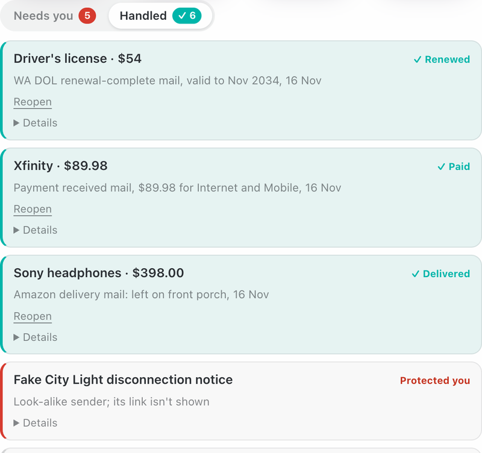
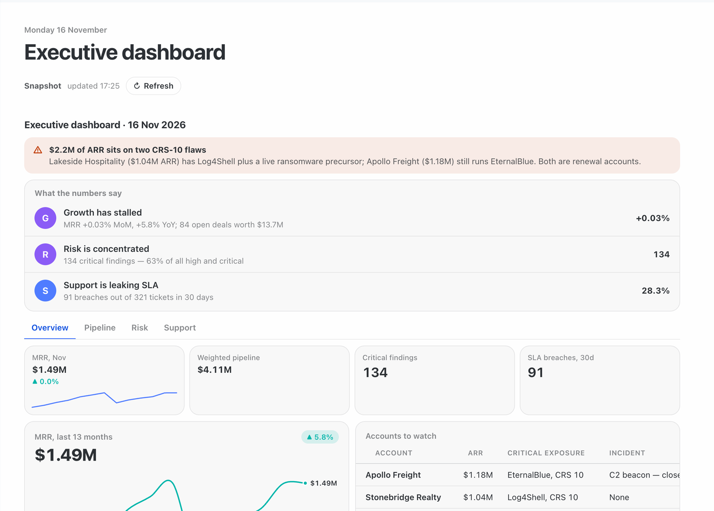
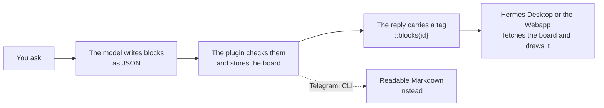
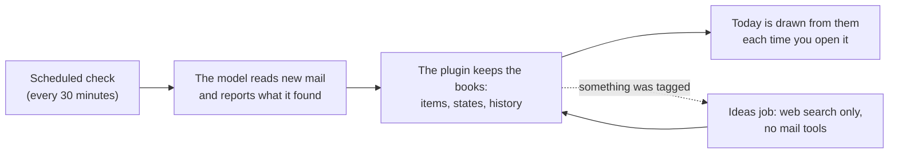

<p align="center">
  <picture>
    <source media="(prefers-color-scheme: dark)" srcset="assets/banner-dark.svg">
    
  </picture>
</p>

<p align="center">
  <a href="LICENSE"></a>
  
  
  
  <a href="https://github.com/sagarmainkar/hermes-genui/actions"></a>
</p>

**Ask "How's the market?" and get a chart, not a paragraph.** Hermes GenUI lets your Hermes agent answer with
**real, interactive UI** inside Hermes Desktop and the Hermes Webapp: charts, tables, day-by-day plans, photo strips,
calculators with live charts, forms, checklists that remember your ticks, and step-by-step explainers.

**New in 0.3:** a **Today** page kept up to date by a personal assistant you set up in one sentence, and
**dashboards from your own data** that you keep in the sidebar and refresh. [See what's new](#-new-in-03).

https://github.com/user-attachments/assets/0db53c5b-6528-486d-88d2-4eebe5acdc85

The 0.3 film, 73 seconds with sound: ask for a Today page and watch it track bills, orders and renewals, then ask
for an executive dashboard and keep it in the sidebar. **[▶ Also on YouTube](https://youtu.be/kEnId7u-i9I)**

**On this page:** [Install](#-install) · [Where it works](#-where-it-works) · [Today](#-today-a-personal-assistant-in-your-own-hermes) ·
[Dashboards](#-dashboards-from-your-own-data) · [The blocks](#-the-blocks) · [What you can ask](#-what-you-can-ask) ·
[How it works](#-how-it-works) · [Privacy](#-privacy-network-and-security) · [Troubleshooting](#%EF%B8%8F-troubleshooting)

---

## ✨ What it looks like

| | |
|:---:|:---:|
|  |  |
| **"Compare NVDA, AAPL and MSFT over the past year"** | **"Plan a 4-day Yosemite trip for two in May, around $2,000"** |
|  |  |
| **"Explain how transformers work"** | **"I put 6% in my 401(k). What if I raise it to 10%?"** |

The model decides **what** to show. The plugin decides **how** it looks, so every answer comes out in one
consistent, accessible design that follows your light or dark theme and your language's number format
(4.21B, 4,21 Mrd., ₹18.4L).

**See boards drawn in a chat.** A one-minute demo with sound: a Yosemite trip plan, a stock comparison, an explainer
and a 401(k) what-if. **[▶ Also on YouTube](https://youtu.be/jknqytZrXAw)**

https://github.com/user-attachments/assets/5b274da9-b756-4bb6-be72-9a5427fadc0d

## 🆕 New in 0.3

- **[Today](#-today-a-personal-assistant-in-your-own-hermes), with a personal assistant.** It checks your mail and
  calendar every 30 minutes and keeps track of bills, renewals, orders and replies you owe until each one is paid,
  renewed, delivered or answered. What needs you, what's overdue and what it handled are on one page.
- **[Dashboards from your own data](#-dashboards-from-your-own-data).** Ask for a dashboard and it's drawn in the chat
  from your MCP servers and tools. **Keep in sidebar** turns it into a page; **Refresh** redraws it with fresh numbers.
- **New blocks:** a weather strip, Up next cards and a day's calendar.
- **The Hermes Webapp** draws everything Hermes Desktop does, once the plugin is
  [switched on in that browser](#-using-the-webapp-switch-it-on-in-each-browser).
- **Fixes from the community:** boards drawn in another profile now load, price charts work on Windows, tiles can
  be plain facts, and a tile's text reads in three lines. Thanks to everyone in [Credits](#-credits).

The full list is in the [changelog](CHANGELOG.md).

## 🚀 Install

You need [Hermes Agent](https://github.com/NousResearch/hermes-agent) 0.22.5 or later with Hermes Desktop or the
Webapp. Today, kept dashboards and the Webapp were built and tested on Hermes 0.23.1.

**1. Install the plugin** on the machine that runs Hermes:

```bash
hermes plugins install sagarmainkar/hermes-genui --enable   # add -p <profile> for a profile other than default
hermes config set tools.tool_search.enabled off             # keeps the plugin's tools in view (why: below)
hermes gateway restart                                       # loads the plugin's tools and data routes
```

Already have it? `hermes plugins update hermes-genui`, then `hermes gateway restart`.

> [!NOTE]
> **Several profiles?** Install it in the **default** profile as well as the profiles you use it in. With the plugin
> in two or more profiles but not in the default one, Hermes Desktop can keep reloading it
> ([why](#%EF%B8%8F-troubleshooting)).

Prefer clicking? In Hermes Desktop, open **Capabilities → Plugins → Install from Git** and enter
`sagarmainkar/hermes-genui`, then run the second and third lines above.

**2. Switch on the drawing half** where you chat:

1. Open **Capabilities → Plugins**.
2. Pick the **profile** you installed into at the top of the page. The list is per profile.
3. Open **hermes-genui** and switch **Desktop** on.

In the Webapp this switch is per browser: see [the note below](#-using-the-webapp-switch-it-on-in-each-browser).

**3. Start a new chat and try:**

> *Compare NVDA, AAPL and MSFT over the past year* · *Plan a 4-day Yosemite trip for two* · *Explain how transformers
> work* · *Set up my personal assistant with sample data* · *Create an executive dashboard*

> [!IMPORTANT]
> **Why turn off tool search?** Hermes's default (`auto`) hides plugin tools behind a search bridge, where the model
> has to write each board as escaped text inside another call. Big boards often break there: you'll see red
> "Unnamed call" rows before the board appears. With tool search off, every tool in that profile is offered on each
> message, so a profile with many MCP servers uses more tokens. A separate profile just for hermes-genui avoids that.

### ✅ Where it works

| Where you chat | Boards in chat | Today and sidebar pages | To turn it on |
|---|:---:|:---:|---|
| **Hermes Desktop** (the app) | ✅ | ✅ | Switch **Desktop** on once, in step 2 above. |
| **Hermes Webapp** (`hermes webapp`) in Chrome, Edge and other Chromium browsers | ✅ | ✅ | Switch **Desktop** on in **each browser, at each address**. See the note below. |
| **Webapp in Firefox, or on an Android phone** | Not tested yet | Not tested yet | Same switch as other browsers. |
| **Webapp in Safari on a Mac** | ✅ | Not tested yet | Hermes's Capabilities page crashes in Safari, so use the [workaround](#safari-on-a-mac). |
| **Webapp on iPhone or iPad**, in any browser | ❌ | ❌ | Doesn't work yet: the Hermes Webapp itself fails to render there. See [iPhone and iPad](#iphone-and-ipad). |
| **Hermes dashboard** (`hermes dashboard`) | ❌ shows a raw `::blocks` line | ❌ | Nothing to switch on: it has no block renderer ([#4](https://github.com/sagarmainkar/hermes-genui/issues/4)). Use Desktop or the Webapp. |
| **Telegram, the CLI, other apps that use Hermes as a backend** | 📝 text and Markdown tables | ❌ | Nothing to do: the plugin sees the chat can't draw and has the model write text. |

The personal assistant's checks and dashboard refreshes run on the machine that runs Hermes, whichever app you look
at them in. The plugin is developed on macOS; its tests run on Linux; Windows has had one fix from the community and
isn't tested by the maintainer.

What each part needs beyond the install:

| Feature | Needs |
|---|---|
| Boards in chat, market prices, photos | Nothing more. |
| Today with the sample mailbox | Nothing more. |
| Today with your real mail and calendar | An MCP server with mail and calendar tools, enabled in that profile (a Gmail server, for example). |
| Prepared ideas and pay links on Today | Hermes's web search set up in that profile. |
| Dashboards from your own data | MCP servers or other tools that return your data. |

### 🌐 Using the Webapp: switch it on in each browser

> [!IMPORTANT]
> The Webapp remembers which plugins are on **in the browser, not on the server**, and plugins start **off**. So you
> switch **Desktop** on separately for:
>
> - **each browser and device** (Chrome on your laptop, Edge, the browser on your phone);
> - **each address** you open the Webapp at: `localhost:9120`, `127.0.0.1:9120` and `my-mac.local:9120` are three
>   different sites to a browser, even though they are the same Hermes;
> - a **private window**, or after you clear the browser's site data.
>
> The signs that it's off: a reply shows a line like `::blocks{id="…"}` instead of a board, or **Today** and your
> dashboards are missing from the sidebar. Open **Capabilities → Plugins → hermes-genui**, switch **Desktop** on and
> reload the page. Being on in the Desktop app doesn't carry over.

Sidebar pages belong to a profile: after switching profiles, the rows for that profile appear within a few seconds.

### Safari on a Mac

> [!WARNING]
> In Safari, Hermes's Capabilities page crashes with *"workspace failed to render: Can't find variable:
> requestIdleCallback"*, so you can't reach the switch. It's a Hermes bug ([hermes-agent#148538](https://github.com/NousResearch/hermes-agent/issues/148538)). Until it's fixed, turn the
> plugin on from the Console: open the Webapp, press **⌥⌘C** (turn on *Show features for web developers* in Safari's
> Advanced settings first), paste this line and press Return:
>
> ```js
> localStorage.setItem('hermes.desktop.pluginDecisions.v2', JSON.stringify({...JSON.parse(localStorage.getItem('hermes.desktop.pluginDecisions.v2') || '{}'), 'hermes-genui': true})); location.reload()
> ```
>
> It saves the same setting the switch saves and leaves your other plugins as they are.

### iPhone and iPad

> [!CAUTION]
> **The Hermes Webapp doesn't work on iPhone or iPad yet, in any browser**, so boards, Today and your dashboards
> can't be drawn there. Every browser on iPhone and iPad (Safari, Chrome, Firefox, Edge) runs on the same engine, and
> the Webapp's pages fail on it with *"workspace failed to render: Can't find variable: requestIdleCallback"*.
>
> It's the same Hermes bug ([hermes-agent#148538](https://github.com/NousResearch/hermes-agent/issues/148538)) and needs a fix in Hermes, not in this plugin. The issue has the details and
> the workarounds people have tried; none of them is tested with this plugin. Until it's fixed, use Hermes Desktop,
> or the Webapp on a computer. On a phone, Telegram and other chat apps still get every answer as text.

### Hermes on one machine, Desktop on another

Say a Mac mini at home and a laptop that connects to it. Run the install commands on the machine that runs Hermes.
Then, on each computer whose Desktop app connects to it, use **Install from Git** with `sagarmainkar/hermes-genui` and
switch **Desktop** on. The drawing half lives in each Desktop app, not on the server.

### 🔑 Optional keys, for more and better photos

Photos work with **no keys at all**, from Wikimedia Commons, Openverse and the pictures on pages your own web search
finds. Each key below adds one more source. Add them under **Settings → Plugins → hermes-genui** in Hermes Desktop;
they're stored by Hermes, never by the plugin.

| Key | Adds | Get one |
|---|---|---|
| `UNSPLASH_ACCESS_KEY` | Unsplash photos (only the *Access Key*; the secret key is never used) | [unsplash.com/developers](https://unsplash.com/developers) |
| `PEXELS_API_KEY` | Pexels photos | [pexels.com/api](https://www.pexels.com/api/) |
| `TAVILY_API_KEY` | Tavily image search | [tavily.com](https://tavily.com) |

## 📬 Today: a personal assistant in your own Hermes


Say **"Set up my personal assistant"** (or **"Build my Today page"**). Hermes asks where your mail and calendar come
from, creates a scheduled check that runs every 30 minutes, and puts a **Today** page in the sidebar. No real mail
handy? Say **"Set up my personal assistant with sample data"** to try it on a made-up mailbox first.

**What the assistant does on each check**

- It looks at what it's **already tracking**, then reads new mail and the next two weeks of your calendar.
- It **opens** an item for anything that needs you: a bill, a renewal (licence, certificate, subscription), an order,
  a reply someone is waiting for, a security alert, a family plan.
- It **closes** an item when the proof arrives: a payment receipt for the same amount, a "renewal complete", a
  delivery notice. Every close records what happened and the mail that proves it.
- It **flags** a mail from a look-alike sender that asks for money or a login, and never repeats its link.

**What you see on Today**

| Part | Shows |
|---|---|
| **The band on top** | The greeting, today's weather and one sentence: *1 overdue, 8 need you, and ✓ 4 handled.* |
| **Up next** | Cards for what's due and what's coming, each with its date. Overdue ones come first. |
| **Needs you** | Each open item with its state (*Overdue · 1 day*, *Arriving today*, *In 3 days*), one button that asks Hermes for help with it, and **Details**: who sent it, when, the amount or order number, and what has happened so far. With prepared ideas on, a bill or renewal also gets a **Pay on …** link to the company's own page. |
| **Handled** | What the assistant closed in the last 3 days (*✓ Paid*, *✓ Renewed*, *✓ Delivered*) with the reason and a **Reopen** button, what it's quietly following, and what it flagged. |
| **Prepared for you** | Optional. Photo ideas found before you ask: gifts for a birthday on your calendar, recipes when a guest is coming to dinner, places for a trip. |



**What it never does.** It never sends, pays, replies, accepts or deletes anything. A button only puts a sentence in
the message box for you to send. Overdue and due-soon are worked out from the dates by the plugin, not guessed by the
model, so a bill turns red at midnight even if no check runs. A payment link appears only when it's on the same
website the bill came from. Mail is treated as untrusted text: nothing written in a mail is followed as an instruction.

**Change it by asking**

| Say | What happens |
|---|---|
| *Design my Today page* | One form: your name, the weather city, whether to show prepared ideas and today's calendar, extra tabs for bills or orders, and up to three sections from your MCP servers. |
| *I paid the electricity bill* · *Ignore the wedding invite* | Marks that item done or dismissed. |
| *Check every hour instead* · *Pause the assistant* · *Stop the assistant* | Changes, pauses or removes the scheduled check. |
| *Bring in the next sample mail* · *Reset the sample mailbox* | Sample data only: a payment, a renewal and a delivery arrive, so you can watch items turn green; or start over. |

> [!NOTE]
> **Each check is a run of your profile's model.** With real mail, new messages are sent to that model every 30
> minutes, the same way a chat would send them. If the model is a cloud model, your mail goes to that provider. To
> keep a profile's data on your machine, use a local model there, or turn on the plugin's **No scheduled jobs that
> send data to the model** setting (`local_only`) in that profile: the plugin then turns off the real-mail assistant,
> prepared ideas and kept dashboards there. The sample mailbox costs nothing while it's idle: a small script skips the check when no new mail arrived.

## 📊 Dashboards from your own data



Say **"Create an executive dashboard"** (or a security dashboard, a sales pipeline, anything your tools can answer).
Hermes calls your MCP servers and other tools, then draws the dashboard right in the chat: a one-line verdict, a few
insights, tabs per area, charts beside tables, and buttons that ask the next question.

**Keep it.** Tap **Keep in sidebar** under the dashboard, or say *"pin it to my sidebar"*. That exact design becomes
its own page in the sidebar, next to Today.

**Refresh it.** A kept page is a snapshot with its time on it. **Refresh** runs a background Hermes job that repeats
exactly the tool calls that built the page, then redraws the same layout with the new numbers and rewrites the
insights. Because the calls are recorded, two refreshes on unchanged data give the same numbers. Want it automatic?
Say *"refresh it every morning at 8"*.

**Good to know**

- Only calls that read are recorded. A tool that sends, creates, updates or deletes is refused when you keep the
  page, and SQL must be one read-only query.
- What an executive, security or sales dashboard should cover lives in short briefs in [`templates/`](templates/).
- A refresh sends your tools' results to the profile's model, like the chat that drew the dashboard did.
- Pages belong to the profile they were made in. *"Remove the Security posture page"* deletes one.

## 🧱 The blocks

| Family | Blocks |
|---|---|
| 📈 **Charts** | line (with gain/loss colouring), columns, horizontal bars, donut, pie, stacked, area, combo, heatmap, all with hover cards and keyboard support |
| 🔢 **Numbers** | KPI cards with trend lines, single stats, progress toward a goal, streaks |
| 📋 **Tables and lists** | sortable tables with mini bars, ranked lists with icons or photos |
| 🗓️ **Plans and days** | timelines (day by day, timed stops), checklists whose ticks are saved, a day's calendar with the week, Up next cards, a weather strip |
| 🖼️ **Media** | photo strips with credits, cover tiles, flash cards |
| 🎛️ **Interactive** | calculators with sliders and live charts, forms that ask before a big answer, buttons that ask the next question |
| 🧠 **Explainers** | flow diagrams whose boxes show what's inside them as you step through, simulations you play over time (with sliders), and stacks you can turn in 3D |
| 🧩 **Layout** | columns, grids, tabs, foldable sections, rows, headings, callouts, sources |

Plus **recipes**: ready-made plans the model follows for common asks. They cover trip planning, comparisons,
what-ifs, stock dashboards, dashboards, reports, learning, explainers, trackers, the personal assistant and the Today
page. A **recipe builder** lets you save your own.

## 💬 What you can ask

**Pretty much anything.** There's no fixed set of screens: the model builds each answer from the blocks above to
fit the question, so something nobody planned for still comes back as a report, a dashboard or a walkthrough. For
bigger asks it may show a short form first to check the details.

**Bring your own data.** The blocks aren't tied to this plugin's data tools. Whatever your agent can reach (your own
tools, MCP servers, files, web search) can feed a board: ask it to fetch the data and show it, and the model lays it
out with the same components.

> [!TIP]
> **Use a capable model.** A good board means planning a layout and writing valid structured data in one go. Tested
> so far:
> - **DeepSeek V4.1 Flash** (Ollama Cloud): works great. The personal assistant and kept dashboards were built and
>   tested on it.
> - **Qwen3.6 35B-A3B** (local, MLX 4-bit): works well.
> - **Gemma 4 26B-A4B** (local): fine for small boards, but big ones sometimes come back as text instead of a drawing.
>
> Each model lays out its answers its own way; the plugin keeps the look the same. If boards come out thin or keep
> failing their checks, try a stronger model.

| | Try asking |
|---|---|
| 📈 **Markets** | *How's the S&P 500 doing this year?* · *Compare NVDA, AAPL and MSFT over the past year* · *Build a dashboard comparing Tesla, Ford and GM, with a tab each* · *How's the NIFTY doing this year?* |
| 💰 **Money** | *Mortgage on a $450,000 home, let me play with the rate* · *What will $500 a month be worth in 20 years?* · *I put 6% in my 401(k). What if I raise it to 10%?* · *EMI on a ₹40 lakh home loan* |
| ✈️ **Trips and plans** | *Plan a 4-day Yosemite trip for two in May* · *Show me Kyoto* · *A packing checklist for Iceland in June* · *Plan a 5-day Kerala trip for a family of four* |
| 📊 **Reports** | *Write a report on the electric vehicle market* · *Top 10 companies by market cap* · *Where does my $4,000 a month go?* |
| 🧠 **Learn and explain** | *Explain how transformers work* · *How does a card payment go through?* · *Explain how compound interest grows my money* · *Make me flash cards on photosynthesis* |
| 🔌 **Your own data** | *Read sales.csv and build me a dashboard* · *Use the GitHub tools to chart my open issues by label* · *Pull today's tickets from the helpdesk MCP and rank them by urgency* |
| 📊 **Dashboards you keep** | *Create an executive dashboard* · *Design a security dashboard* · *Pin it to my sidebar* · *Refresh it every morning at 8* |
| 📬 **Assistant and Today** | *Set up my personal assistant* · *Build my Today page* · *I paid the electricity bill* · *Check every hour instead* · *Stop the assistant* |
| 🔁 **Track** | *Track my 30-day walking streak* · *A checklist for moving house* (ticks are saved) |
| 🛠️ **Your own** | *Make this a recipe so you always build my weekly review this way* (the recipe builder saves it) |

Buttons under each board ask the obvious next question, such as *Make it $1,500*, *Add a day in Sequoia* or *More
technical*, so you can keep going without typing.

## 🔍 How it works



- **The model** picks blocks from a short menu in the `show_blocks` tool's description, gets the fields of the ones
  it picked from `block_guide`, and gets a short drawing rule in its system prompt.
- **Tools fetch real data:** `market_history` for prices, `find_photos` for photos. So numbers and pictures come from
  sources, not memory.
- **Every block is validated** before it's stored, and the model gets exact errors to fix. The readers in Desktop
  also skip anything malformed, so a bad block never breaks the rest of the board.
- **Outside Desktop and the Webapp** (Telegram, the CLI and other chat apps), the same board is sent as readable
  Markdown.
- **One surface falls through both paths:** the Hermes **dashboard** (`hermes dashboard`) is served as a *local*
  session, so it reports `local`, the same value Hermes Desktop reports. The drawing rule therefore still applies,
  `show_blocks` is still offered and the text fallback is skipped, yet that surface has no block renderer, so the
  tag arrives as text.

**Today and kept pages** work without a model call when you open them:



- **The model judges, the plugin keeps the books.** The check can open, move or close an item, and a close needs a
  reason. Dates, states, counts and links are worked out in code.
- **Two jobs, kept apart.** The check may use the assistant's tools and your mail server, nothing else. The ideas
  job may search the web and has no way to read mail: it gets a few plain words such as *Thanksgiving dinner*.
- **Live parts** of a page (weather, stock prices, system stats) are fetched by the plugin on a timer while a
  window is open: system every 5 s, stocks every minute, weather every 15 minutes.

## 🔒 Privacy, network and security

**What leaves your machine**

| When | Who is contacted |
|---|---|
| Market prices and stock sections | Yahoo Finance (`query1.finance.yahoo.com`) |
| Weather on Today and weather sections | Open-Meteo (`api.open-meteo.com`, `geocoding-api.open-meteo.com`), with the city you chose |
| Photos, in chat and for prepared ideas | Wikimedia Commons and Openverse APIs; Unsplash, Pexels or Tavily only if you added their keys; your configured web search; up to 256 KB of the top result pages (read only to their `</head>`) for their preview pictures; each photo host, briefly, to check the picture loads |
| Prepared ideas and pay links | Your configured web search, with a few plain words from the item (*birthday cake, flowers*) or a company's name (*Xfinity pay bill online*). Never mail text. |
| The assistant's checks | Your **profile's model**: each check sends it the new mail, read through your own mail server. A cloud model means your mail goes to that provider. |
| Refreshing a kept dashboard | Your **profile's model**: it gets the results of the recorded tool calls. |

**What stays local**, in your profile under `plugin-data/hermes-genui/`:
- **Boards** are saved as JSON, with checklist ticks next to them.
- **Photo URLs** (`photo-urls.txt`): the URLs `find_photos` returned, plus https image URLs returned by Hermes's own
  `image_generate`. Local file paths are never recorded. These are the only images a block may draw.
- **The stand-in photo tool** is off by default. Switching `photo_test_tool` on registers `standin_photos`, which
  returns a fixed https link, a local path or a dead link so the photo path can be tried without an image key.
- **The assistant's memory** (`assistant/`): its settings, the items it tracks (title, dates, amount, the sender,
  when the mail came, up to four short facts such as an order number, and a history), a log of its checks, and the
  next two weeks of your calendar. Chats see one-line summaries of items, never mail text.
- **Kept dashboards** (`pages/`): each page's blocks, its layout and the tool calls a refresh repeats.
- **Today's layout** (`dashboard.json`).
- **Scheduled jobs** are ordinary Hermes jobs you can see under **Scheduled jobs**: the check, the ideas job and one
  refresh job per kept page. With the sample mailbox, setup also writes one small script into the profile's
  `scripts/` folder; it's removed when you stop the assistant.
- **In the browser:** which of Needs you or Handled you last looked at.
- System stats and your scheduled-task list are read on the machine running Hermes and never sent anywhere.
- Desktop lists sessions from every profile, so a board that isn't in the active profile is looked up in your other
  profiles' folders on the same machine. Any profile can then load another profile's board by its id.
- There's no telemetry and no account.

**No scheduled jobs that send data to the model.** This plugin setting (`local_only`) turns off the three things
that send a profile's data to its model on a schedule: the real-mail assistant, prepared ideas and kept dashboards.
Jobs made before you switch it on stop reading data: the mail check reads no mail, and a kept page keeps its last
snapshot instead of refreshing. Chat and the boards you ask for still work, and still go to the profile's model, so
for a profile whose data must stay on your machine, use a local model too. Switch it on in the plugin's settings in
Hermes Desktop, or in that profile's `config.yaml`:

```yaml
plugins:
  entries:
    hermes-genui:
      settings:
        local_only: true
```

It takes effect on the next tool call, with no restart.

**Your scheduled jobs stay yours.** If you delete the assistant's mail check or ideas job, or change a kept
dashboard's refresh schedule, the model asks you before putting any of them back.

**What the plugin adds to the model's context:**
- a short drawing rule in the system prompt (under 1,500 characters);
- the `show_blocks` tool description (a short menu of the blocks, about 2,500 characters), and the descriptions of
  the plugin's other tools;
- a block's fields and example, from `block_guide`, only when the model is about to draw that block;
- a one-line reminder next to messages that ask for something visual. This is added only where boards draw;
- a recipe, only when your request matches one.

**Safety by design:**
- **The model never sends code.** It sends data only: no HTML, scripts or SVG. Every block is drawn by the plugin's
  own components.
- **Mail is untrusted.** The check is told never to follow instructions in a mail, it runs with only the assistant's
  tools and your mail server, and nothing it records can carry a link from a mail.
- **Links are checked in code.** A pay or renew link is kept only if it is https and on the same site the mail came
  from; anything a browser could read differently (a backslash, an `@`, odd characters) is refused.
- **Buttons only fill the message box** on Today and kept pages, and can't carry slash commands, shell lines or
  `@file` references anywhere.
- **Photos are fetched over https only, from public addresses only.**
  - DNS is pinned against rebinding.
  - Each redirect is checked again, up to 3.
  - Size and time limits apply.
- **A kept dashboard repeats read-only calls only**, on the servers it was built from.
- **Calculator formulas** are read by a small parser with no `eval` and with operation budgets.
- **Board size, depth, text length and counts are all capped.**

Found a security issue? Please see [SECURITY.md](SECURITY.md).

## 🛠️ Troubleshooting

| You see | Do this |
|---|---|
| The plugin isn't in **Capabilities → Plugins** | Switch the profile selector at the top to the profile you installed it in. |
| A literal `::blocks{id="…"}` line, in the Webapp | The plugin is off in this browser or at this address. Switch **Desktop** on in **Capabilities → Plugins**: see [Using the Webapp](#-using-the-webapp-switch-it-on-in-each-browser). |
| **Today** or your dashboards are missing from the sidebar | Same cause in the Webapp. Otherwise you're in another profile: pages belong to the profile they were made in, and show a few seconds after you switch to it. |
| "This page isn't in this profile…" | Switch back to the profile the page was made in, or ask Hermes to make it here. |
| Today says nothing needs you, right after setup | The first check is still running. Look under **Scheduled jobs → Personal assistant check**, or say *Run the assistant's check now*. |
| "Couldn't load this block" | Run `hermes gateway restart` after installing or updating. If it's one reply in an otherwise working chat, the model wrote a tag without drawing: ask *"draw it with blocks"*. |
| Hermes Desktop flickers, or an open page closes by itself after a few seconds | A Hermes bug when the plugin is installed in two or more profiles but not in the default one: Desktop and the gateway each copy the plugin's drawing half from a different profile, so it is replaced and reloaded every few seconds. Install the plugin in the default profile too (`hermes plugins install sagarmainkar/hermes-genui --enable`), then reload Desktop. |
| A board arrives as text | You're outside Hermes Desktop and the Webapp (Telegram, the CLI), which is by design. In Desktop, check the plugin's **Desktop** switch. |
| "workspace failed to render: Can't find variable: requestIdleCallback" | A Hermes bug ([hermes-agent#148538](https://github.com/NousResearch/hermes-agent/issues/148538)) in Safari and in every browser on iPhone and iPad. On a Mac, use the [Safari workaround](#safari-on-a-mac). On iPhone or iPad the Webapp [doesn't work yet](#iphone-and-ipad). |
| A literal `::blocks{id="…"}` line, in the Hermes dashboard | The dashboard draws nothing and reports itself as `local`, like Desktop, so the Markdown fallback is skipped too. Open the chat in Hermes Desktop or the Webapp, or ask for a Markdown table. |
| Red "Unnamed call" rows, or `tool_call 'calls' is not valid JSON` | Tool search is on. Run `hermes config set tools.tool_search.enabled off` (add `-p <profile>`), then start a new chat. |
| The model built an HTML widget instead | Start a new chat, or ask "draw it with blocks". Tool search being on can also cause this; see Install. |
| Few or slow photos | Add a photo key above. A source that fails is skipped automatically and retried after 10 minutes. |

## 🤝 Contributing

New recipes, fixes and new blocks are all welcome. See [CONTRIBUTING.md](CONTRIBUTING.md) for:
- the layout;
- how to add a recipe, a data tool or a block type;
- the checks every pull request must pass.

Bigger ideas, new block types included, start in [Discussions → Ideas](https://github.com/sagarmainkar/hermes-genui/discussions/categories/ideas).
Each block costs space in the model's guide on every message, so we agree on the design there before the code.

## 💛 Credits

Built by [Sagar Mainkar](https://github.com/sagarmainkar), with Claude as a pair programmer. Made for the
[Hermes Agent](https://github.com/NousResearch/hermes-agent) community.

**Thank you** to the people who made 0.3 better:
[@apoapostolov](https://github.com/apoapostolov) (found and fixed price charts on Windows),
[@Huy3ko](https://github.com/Huy3ko) (documented the surface that can't draw),
[@phild4747](https://github.com/phild4747) (tiles that are plain facts),
[@nubsors](https://github.com/nubsors) (reported boards that wouldn't load across profiles),
[@zunami](https://github.com/zunami) (asked for a clear list of where boards draw) and
[@leosgarza](https://github.com/leosgarza) (traced a blocked catalog install to a scanner false alarm, and made the
text on tiles readable).

Sagar also makes **[Odie](https://github.com/sagarmainkar/odie)**, an open-source (MIT) personal assistant that lives
on your Mac and talks to you on your phone, with this kind of UI built in.

Released under the [MIT licence](LICENSE).
